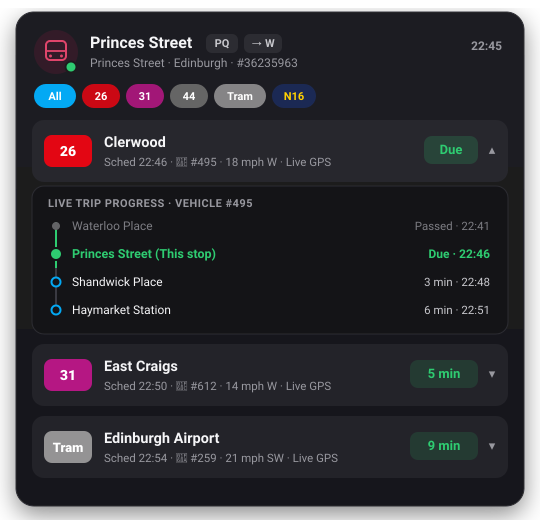
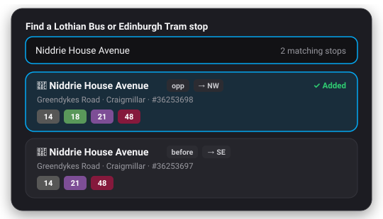

<div align="center">


# Lothian Buses & Edinburgh Trams

**Live Edinburgh & Lothians bus and tram departure boards, vehicle GPS telemetry, a bundled Mushroom-style Lovelace card, and voice-ready schedule sensors for Home Assistant.**

[](https://github.com/vinodmishra/ha-lothianbuses/actions/workflows/ci.yml)
[](https://my.home-assistant.io/redirect/hacs_repository/?owner=vinodmishra&repository=ha-lothianbuses&category=integration)
[](LICENSE)

</div>

---

Real-time departure boards and vehicle tracking for **Lothian Buses**, **Lothian Country**, **East Coast Buses**, **NightBus**, and **Edinburgh Trams** — complete with an auto-registered Lovelace dashboard card, instant stop search, and natural-language schedule sensors exposed to **Home Assistant Assist**.

<div align="center">
  
</div>

---

## Highlights

- **4,316 Stops Built In.** Ships with the complete stop and route directory across Edinburgh, Midlothian, East Lothian, West Lothian, and Fife — including all **Edinburgh Trams** stops to Newhaven — pre-mapped with routes, street names, localities, and compass directions.
- **Search & Add Stops Directly on Your Dashboard.** Type a stop name (`Princes Street`), street, locality (`Leith`), route number (`26`, `Tram`, `N16`), or 8-digit SMS stop code (`36238285`) in the card editor. Clicking any result adds the stop to Home Assistant and binds the card in one step.

<div align="center">
  
</div>

- **Interactive Live Trip Progress.** Click any live departure row on the card to open a real-time stop-by-stop timeline showing passed stops, your current stop, and upcoming stops with live ETAs.
- **Official Lothian & Tram Route Colours.** Authentic colour pills for Lothian Buses, Lothian Country, East Coast Buses, NightBus, and Edinburgh Trams, plus interactive route filter chips in the card header for busy stops.
- **Live Fleet Telemetry.** Displays fleet vehicle numbers (`🚌 #495`, `🚊 #259`), live GPS speed (mph), compass heading, and `Diverted` / `Part route` disruption badges.
- **Built for Home Assistant Assist & Voice.** Automatically exposes natural-language schedule sensors (`Upcoming schedule`, `Next service`, `Next departure time`, and per-route `Route X schedule` sensors) to Assist so you can ask *"When is the next bus?"* or *"What is the Route 14 schedule?"* out of the box.

---

## Install

### 1. Add via Home Assistant Marketplace / HACS (Recommended)

[](https://my.home-assistant.io/redirect/hacs_repository/?owner=vinodmishra&repository=ha-lothianbuses&category=integration)

1. Click the button above (or open **Marketplace** / **HACS** in Home Assistant → **⋮** → **Custom repositories** and add `https://github.com/vinodmishra/ha-lothianbuses` with category **Integration**).
2. Download **Lothian Buses & Edinburgh Trams**.
3. **Restart Home Assistant**.

### 2. Configure the Integration

[](https://my.home-assistant.io/redirect/config_flow_start/?domain=lothian_buses)

1. Click the button above (or go to **Settings → Devices & Services → Add Integration** and search for **Lothian Buses & Edinburgh Trams**).
2. Choose **Add stops later from the dashboard card editor** or search for stops right away.
3. Open any Lovelace dashboard → **Edit** → **Add Card** → **Lothian Buses & Edinburgh Trams Card** and search for your stop.

<details>
<summary><b>Manual Installation</b></summary>

1. Download or clone this repository.
2. Copy `custom_components/lothian_buses` into your Home Assistant `<config>/custom_components/` folder.
3. Restart Home Assistant.
</details>

---

## Voice & Home Assistant Assist Sensors

Each stop creates a device with sensors that are **automatically exposed to Home Assistant Assist (`conversation`)**:

| Sensor | Entity ID Pattern | Example State | Purpose |
| :--- | :--- | :--- | :--- |
| **Next arrival** | `sensor.*_next_arrival` | `5 min` | Minutes until next departure; powers `custom:lothian-bus-card` |
| **Next departure time** | `sensor.*_next_departure_time` | `2026-11-14T23:04:00+00:00` | Exact `timestamp` of the next departure |
| **Next service** | `sensor.*_next_service` | `Route 14 to Muirhouse in 5 min (23:04)` | Natural-language summary of the very next bus or tram |
| **Upcoming schedule** | `sensor.*_upcoming_schedule` | `14 to Muirhouse: 5 min (23:04); 21 to Gyle Centre: 12 min (23:11)` | Next 4 departures across all routes at the stop (includes `spoken_schedule` attribute) |
| **Route `<X>` schedule** | `sensor.*_route_<x>_schedule` | `To Muirhouse: 5 min (23:04), 35 min (23:34)` | Next 3 departures for a specific route serving the stop |

### On-Demand Schedule Action (`lothian_buses.get_schedule`)

Query any stop or route in automations, scripts, or voice commands and receive both structured departures and a ready-to-speak `spoken_summary`:

```yaml
action: lothian_buses.get_schedule
data:
  stop_id: "36253698"
  route: "14"
  max_departures: 4
response_variable: bus_schedule
```

---

## Lovelace Card (`custom:lothian-bus-card`)

The card is automatically served and registered in Lovelace storage mode on startup. All options can be configured in the visual card editor or via YAML:

| Option | Type | Default | Description |
| :--- | :--- | :--- | :--- |
| `entity` | `string` | *(required)* | Primary stop sensor (`sensor.<stop>_next_arrival`) |
| `title` | `string` | *(auto)* | Custom stop title override |
| `max_departures` | `number` | `6` | Maximum upcoming departures shown (`1`–`20`) |
| `routes` | `string[]` | `[]` | Filter card to specific route numbers (e.g. `["26", "31"]`) |
| `compact` | `boolean` | `false` | Compact single-line rows for dense dashboards |
| `show_header` | `boolean` | `true` | Show the Mushroom-style stop header |
| `show_route_filter` | `boolean` | `true` | Show interactive route filter pills in the header |
| `show_vehicle_info` | `boolean` | `true` | Show fleet badge (`#495`), live GPS speed (mph), and heading |
| `show_clock` | `boolean` | `true` | Show clock in the card header |

```yaml
type: custom:lothian-bus-card
entity: sensor.princes_street_pq_w_next_arrival
title: Princes Street (Westbound)
max_departures: 6
routes:
  - "26"
  - "31"
  - "Tram"
compact: false
show_header: true
show_route_filter: true
show_vehicle_info: true
show_clock: true
```

---

## Data Attribution

- Real-time departure and vehicle telemetry provided by **Lothian Buses / Transport for Edinburgh** (`lothianapi.com`).
- Stop location and locality metadata contains public sector information licensed under the [UK Open Government Licence v3.0](custom_components/lothian_buses/data/LICENSE-OGL.txt) from the Department for Transport **NaPTAN** dataset.
